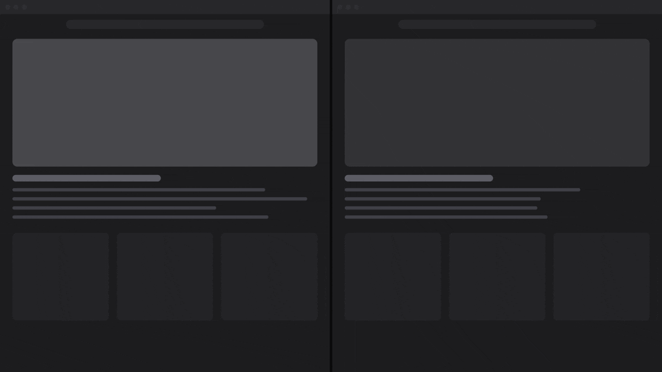

# Hangar

Where your workspaces are parked. A Cmd+Tab-style overview of your [AeroSpace](https://github.com/nikitabobko/AeroSpace) workspaces, built as a [Hammerspoon](https://www.hammerspoon.org) Spoon.

Press a shortcut and every workspace shows up as a tile: its key, its name, a thumbnail of how it looked when you last left it, and the apps on it. Pick one with the arrow keys or its key, release the modifier, and you're there.

<picture>
  <source media="(prefers-color-scheme: light)" srcset="docs/demo-light.gif">
  
</picture>

## Features

- **Thumbnails.** A screenshot of each workspace is taken shortly after you switch to it, so the overview shows what you last saw there.
- **Cmd+Tab feel.** Hold the modifier, move with ← → ↑ ↓, release to go. Press a workspace's key (`1`, `2`, `w`…) to jump straight there. `Esc` cancels, `Return` confirms. Clicking a tile works too.
- **Works with any shortcut.** It works with plain modifiers (⌥Space, ⌃Space…) and with "Hyper" keys made by tools like HyperKey or Karabiner.
- **Raycast-like look** that follows macOS light and dark mode. The header and footer are optional, and the accent colour and all text can be changed.
- **No extra dependencies** beyond AeroSpace and Hammerspoon.

## Requirements

- macOS (tested on macOS 27 with AeroSpace 0.20 and Hammerspoon 1.1)
- [AeroSpace](https://github.com/nikitabobko/AeroSpace)
- [Hammerspoon](https://www.hammerspoon.org) with these permissions in System Settings → Privacy & Security:
  - **Accessibility**, for the shortcut and the keys while the overview is open;
  - **Screen & System Audio Recording**, for thumbnails.

## Install

1. Install Hammerspoon if you don't have it:

   ```bash
   brew install --cask hammerspoon
   ```

2. Get the Spoon:

   ```bash
   git clone https://github.com/mkarpeta/hangar.git ~/Developer/hangar
   mkdir -p ~/.hammerspoon/Spoons
   ln -s ~/Developer/hangar/Hangar.spoon ~/.hammerspoon/Spoons/
   ```

   Or download the repository and copy `Hangar.spoon` into `~/.hammerspoon/Spoons/`.

3. Load it in `~/.hammerspoon/init.lua`:

   ```lua
   hs.loadSpoon("Hangar")
   spoon.Hangar:start()
   ```

4. Tell AeroSpace about workspace changes, so thumbnails stay fresh. Add this to `~/.aerospace.toml`:

   ```toml
   exec-on-workspace-change = ['/bin/bash', '-c',
     'open -g "hammerspoon://hangar?ws=$AEROSPACE_FOCUSED_WORKSPACE"'
   ]
   ```

   If you already use `exec-on-workspace-change`, add the `open -g …` line to that script.
   You can skip this step and set `pollInterval = 0.5` instead (see below). The hook is lighter.

5. Reload Hammerspoon (menu bar icon → Reload Config) and press **⌥Space**.

## Usage

| Key | Action |
| --- | --- |
| Trigger (default ⌥Space) | Open the overview (press again to close and go) |
| Hold the trigger modifiers alone (with `hold` set) | Open the overview |
| ← → ↑ ↓ | Move the selection |
| Release the trigger modifier | Go to the selected workspace |
| `Return` | Go to the selected workspace |
| Workspace key (`1`, `2`, `w`…) | Go there right away, the overview stays open |
| `Esc` | Close without switching |
| Click a tile | Go to that workspace |

Thumbnails appear once you've visited each workspace. Until then a tile shows its app icons.

## Configuration

Pass any of these to `start()`. Everything is optional.

```lua
spoon.Hangar:start({
  -- Shortcut. Releasing all of `mods` goes to the selected workspace.
  -- hold = 0.3 also opens it when `mods` alone are held that long (see "Hold to open").
  trigger    = { mods = { "alt" }, key = "space", hold = nil },
  keyLabel   = nil,          -- modifier shown in the key hints; default built from mods, e.g. "⌥"

  -- Which workspaces to show, in order. Default: `aerospace list-workspaces --all`.
  workspaces = { "1", "2", "3", "4", "5", "6", "7", "8", "9", "0" },
  names      = { ["1"] = "Mail", ["2"] = "Code", ["3"] = "Chat" },

  columns    = 5,
  maxWidth   = 1180,         -- points
  header     = true,         -- title bar
  footer     = true,         -- key hints
  theme      = "auto",       -- "auto" | "dark" | "light"
  accent     = "#ff6363",

  -- All UI text, e.g. for another language.
  strings    = {
    title = "Workspaces", current = "Current", empty = "Empty", noPreview = "No preview",
    workspace = "Workspace", select = "Select", go = "Go", release = "release",
    jump = "Jump", cancel = "Cancel",
  },

  thumbnails = {
    enabled   = true,
    delay     = 0.45,        -- seconds after a switch before the screenshot
    maxSize   = 720,         -- px
    quality   = 70,          -- JPEG quality
    cropRight = {},          -- e.g. { ["LG HDR"] = 600 }: crop points from the right on that screen
  },

  aerospace    = nil,        -- path to the aerospace CLI; auto-detected
  pollInterval = nil,        -- seconds; poll for workspace changes instead of using the hook
  cacheDir     = "~/.cache/hangar",
  urlEvent     = "hangar",
})
```

Other methods: `:show()`, `:hide([commit])`, `:toggle()`, `:capture([workspace])`, `:stop()`, `:state()`.

## Hold to open

Set `hold` to open Hangar by holding just the modifiers, like holding ⌘ for Cmd+Tab:

```lua
trigger = { mods = { "cmd", "alt", "ctrl", "shift" }, key = "space", hold = 0.3 },
```

Pressing any key or clicking before `hold` seconds have passed cancels it, so quick chords (mods+1, mods+←…) keep working in AeroSpace and other apps. Use `key = false` for hold only.

This needs a remapper that sends real modifier keys, such as [Karabiner-Elements](https://karabiner-elements.pqrs.org). It doesn't work with HyperKey (see below).

## Using a Hyper key (HyperKey, Karabiner…)

Set the trigger to all four modifiers:

```lua
trigger  = { mods = { "cmd", "alt", "ctrl", "shift" }, key = "space" },
keyLabel = "⇪",
```

The overview closes when **none** of the trigger modifiers is held any more, not when one of them goes up. That matters for [HyperKey](https://hyperkey.app). HyperKey turns Caps Lock into ⌘ at the hardware level and adds ⌃⌥⇧ only to the keys you press with it. While you hold Caps Lock, Hammerspoon sees just ⌘, and releasing Caps Lock shows up as ⌘ going up. Karabiner sends all four modifiers, and both work the same here.

The same limit is why **hold to open** doesn't work with HyperKey: holding Caps Lock alone can't be told apart from holding the left ⌘ key. With Karabiner it works. A Caps Lock → Hyper rule for Karabiner:

```json
{
  "description": "Caps Lock → Hyper (⌃⌥⇧⌘)",
  "manipulators": [{
    "type": "basic",
    "from": { "key_code": "caps_lock", "modifiers": { "optional": ["any"] } },
    "to": [{ "key_code": "left_shift", "modifiers": ["left_command", "left_control", "left_option"] }]
  }]
}
```

## How it works

- **Overview:** an `hs.webview` panel. AeroSpace doesn't manage it, so switching workspaces while it's open doesn't hide it.
- **Data:** `aerospace list-workspaces` and `aerospace list-windows` are read each time the overview opens. App icons come from the app bundles.
- **Thumbnails:** on each workspace change, AeroSpace opens `hammerspoon://hangar?ws=N`. About 0.45 s later, `screencapture` grabs the screen and `sips` resizes it into `~/.cache/hangar`. A shot is kept only if you're still on that workspace.
- **Keys:** an `hs.eventtap` is active only while the overview is open. It handles arrows, `Return`, `Esc` and workspace keys, and swallows them so AeroSpace bindings on the same keys don't also fire.

## Troubleshooting

- **Nothing happens on the shortcut.** Check Accessibility permission for Hammerspoon. Check that the shortcut isn't taken by Spotlight, Raycast or Alfred: ⌘Space usually is, which is why the default is ⌥Space.
- **No thumbnails.** Grant Screen Recording permission and reload Hammerspoon. Check the hook in `aerospace.toml`, or set `pollInterval`.
- **Debugging:** add `require("hs.ipc")` to `init.lua`, then:

  ```bash
  hs -c 'return hs.inspect(spoon.Hangar:state())'
  ```

## License

[MIT](LICENSE)
